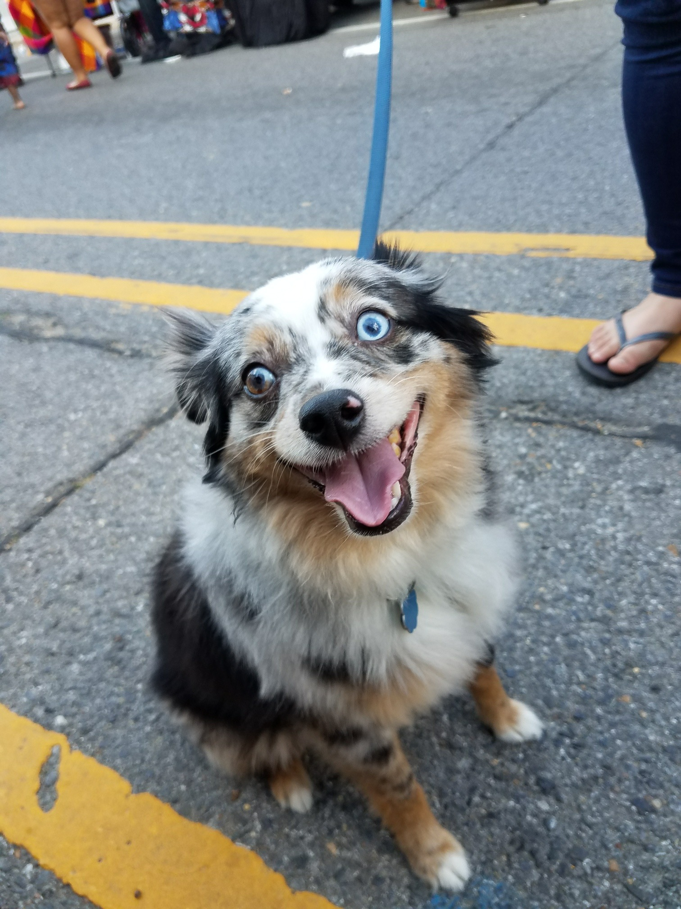

# Gnasher Group

**Student:** Irene Ramos  
**Course:** ITAI 1378  
**Tier:** 1 — one dog-group image-classification task

## Project progression

| Stage | Implementation | Evidence/status |
|---|---|---|
| Version 1 — preserved prototype | Pretrained 1,000-label EfficientNet-B0 plus breed-to-group mapping | Working notebook and eight saved demonstration results |
| Version 2 — final training workflow | Reviewed Stanford Dogs labels; seven-output head training; partial feature fine-tuning | Training notebook updated and saved from Colab on October 13; inspect saved outputs for actual measured results. Reviewed labels and final evaluation evidence need separate confirmation |

The Version 1 snapshot is in [prototypes/v1/](prototypes/v1/README.md).
Existing prototype links remain available. Version 2 is a separate notebook:
[notebooks/Gnasher_Group_Training.ipynb](notebooks/Gnasher_Group_Training.ipynb).

[Open Version 2 in Colab](https://colab.research.google.com/github/IreneAlexRamos/itai1378-project/blob/main/notebooks/Gnasher_Group_Training.ipynb).

The final workflow restores the original training direction while keeping the
prototype as evidence of progression. It supports a reviewed label table,
a capped custom 70/15/15 split, validation-selected weights and threshold,
learning curves, paired V1/V2 test predictions, confusion matrices, and
device-labeled timing. The Version 2 notebook was saved from Colab on October 13,
2026. **Notebook code and saved outputs must be checked before describing a
particular metric as a validated final result.**

See [docs/final_training_plan.md](docs/final_training_plan.md) for the steps,
review responsibilities, experiment limits, and submission evidence.
Stanford Dogs is sourced from ImageNet: its custom test split is held out
from this project's fine-tuning, not verified as unseen during pretraining.
The old eight-photo rate must not be compared directly with a larger test rate.

## Version 1 — problem and implemented solution

Gnasher Group uses a dog photograph to suggest one of seven AKC groups:
Sporting, Hound, Working, Terrier, Toy, Non-Sporting, and Herding.

The notebook uses pretrained ImageNet EfficientNet-B0. A mapping module
sums supported breed scores into AKC group scores while preserving
unsupported-dog and non-dog scores separately.

If the highest group score is below 50%, the final decision is
“Uncertain” and displays the top two group candidates for inspection.
These candidates are not accepted classifications. Group scores are not calibrated guarantees of correctness.
The system does not reliably detect cats or identify mixed-breed ancestry.

**Flow:** photograph → preprocessing → EfficientNet-B0 →
breed-to-group aggregation → suggested group or Uncertain

## Blueprint — original proposal

This section preserves the original plan in [docs/proposal.pdf](docs/proposal.pdf).
It describes proposed work, not completed training or evaluation.

- **Tier and reason:** Tier 1 (Core Project): one lightweight EfficientNet-B0
  model for one image-classification task, using PyTorch/Torchvision and free
  Google Colab resources.
- **Data:** [Stanford Dogs](http://vision.stanford.edu/aditya86/ImageNetDogs/)
  contains 20,580 images across 120 breeds. The plan was to build a
  breed-to-AKC-group table, target approximately 7,000 images with a maximum
  of 1,000 per group, and use a 70/15/15 train/validation/test split.
  Approximately 7,000 is a target, not a guaranteed count after exclusions.
- **Success targets:** at least 85% accuracy on unseen test images; average
  prediction time under one second per image on a Colab GPU; a confusion
  matrix and review of 3–5 incorrect predictions.
- **Risks and responses:** similar-looking breeds → show the top two group
  candidates when confidence is low; class imbalance → capped sampling,
  with class weights and augmentation planned for training. Ambiguous
  breed names need explicit labeling decisions rather than guesses.
- **Resources and budget:** Google Colab GPU, PyTorch, Stanford Dogs,
  GitHub, and Google Drive; estimated cost $0.

| Course week | Original milestone |
|---|---|
| 10 | Submit proposal and create repository |
| 11 | Run pretrained model on sample photographs |
| 12–13 | Prepare labels, train model, and add prediction logic |
| 14 | Test accuracy, speed, and failure cases |
| 15 | Complete demo, README, video, and presentation |

### Make It Yours — breed-to-group labeling

The customization is the breed-to-AKC-group labeling and the veterinary
motivation, not simply running a pretrained model. The planned Stanford Dogs
workflow is:

1. Inventory all 120 source breed identifiers and preserve their exact names.
2. Resolve aliases to a canonical breed/variety using official AKC breed pages.
3. Record the source identifier, canonical name, AKC group, source URL, and
   review status in a table; explicitly exclude unresolved or unsupported labels.
4. Review every row, check for missing and duplicate identifiers, then apply the
   reviewed labels to images before capped sampling and split creation.

The implemented prototype instead maps **ImageNet output labels**, in
[gnasher_group_mapping.py](gnasher_group_mapping.py). Its current assignments
are exported in [data/imagenet_breed_to_group.csv](data/imagenet_breed_to_group.csv).
That export is not a completed Stanford Dogs labeling table or evidence of
independent human review. See [data/README.md](data/README.md) for aliases,
exceptions, sources, and remaining labeling work.

## Run Version 1 in Google Colab

1. Download notebooks/Gnasher_Group_Final.ipynb and gnasher_group_mapping.py
   from this repository.
2. Upload the notebook to Google Colab.
3. Upload the mapping file and your test photograph through Colab’s
   Files sidebar into /content.
4. Set image_path to the photograph’s exact path.
5. Set expected_group from the known breed before testing.
6. Run the cells in order.

The first model load downloads pretrained weights and needs internet
access. The current implementation runs on CPU.

The saved notebook displays the Border Collie example and the results
recorded during the original session. A fresh runtime starts a new
results dictionary; it does not automatically reload previous CSV rows.

## Files

- notebooks/Gnasher_Group_Final.ipynb — implementation, saved outputs,
  reflections, photograph sources, and limitations
- gnasher_group_mapping.py — breed-to-group mapping and score aggregation
- data/imagenet_breed_to_group.csv — current ImageNet label assignments and exclusions
- results/gnasher_test_results.csv — eight recorded photograph results
- requirements.txt — required Python packages
- docs/AI_usage_log.md — AI assistance and student testing log
- docs/proposal.pdf — original blueprint

## Version 1 measured results

Seven dog photographs, one representing each group, and one cat
photograph were tested.

- Correct final dog-group predictions: 6 of 7 (85.7%).
- Dog abstentions: 1 of 7, the husky.
- Cat outcome: Uncertain; this was not a cat classification.
- Average CPU model forward pass: 0.0991 seconds over 30 measured
  runs after five warm-up runs.
- Timing excludes image loading, preprocessing, and group mapping.

The husky’s leading supported group was Working at 20.3%.
Most of its score went to the unsupported ImageNet label “Eskimo dog,”
so the system returned Uncertain.

## Version 2 progress and evidence checklist

The Version 2 notebook has been saved to GitHub from Google Colab. The October 13,
2026 commits confirm that the updated notebook was uploaded, but they do not by
themselves verify that every training, testing, or image-evidence artifact was
published. This checklist separates implemented workflow from submission evidence:

- [x] Preserve Version 1 and its original demonstration results.
- [x] Add the separate Version 2 Stanford Dogs training notebook.
- [x] Save the updated Version 2 notebook from Colab to GitHub.
- [ ] Confirm the reviewed Stanford Dogs breed-to-group table and its provenance.
- [ ] Record the actual final run's training/validation and held-out test metrics,
      distinguishing validation accuracy from test accuracy.
- [ ] Confirm that paired Version 1/Version 2 test comparison, confusion matrix,
      failure examples, and timing are included with their actual outputs.
- [x] Add the authorized Titus example photograph to the demonstration section.
- [ ] Confirm Titus's breed before assigning a ground-truth group; document any
      prediction only when its saved output has been verified.
- [ ] Link the finished narration, demonstration, and final slides.

Do not interpret the original 6/7 demonstration result as final test accuracy.
See [final training plan](docs/final_training_plan.md) for the reproducible workflow.

## Changes from the blueprint

The blueprint proposed Stanford Dogs fine-tuning, approximately
7,000 images, and a 70/15/15 training/validation/testing split.

Version 1 uses pretrained EfficientNet-B0 without additional training, followed
by breed-to-group mapping. Version 2 adds a separate Stanford Dogs dataset and
fine-tuning workflow. Refer to Version 2's saved run artifacts for actual
training and evaluation outcomes; the prototype itself was not fine-tuned.

## Limitations and target comparison

These are eight hand-picked demonstration photographs, not a large
independent benchmark. Poppy and Goober were used during development
of the 50% threshold. Possible overlap between internet photographs
and model pretraining data is unknown. Internet-photo breed labels
were not independently verified.

The original 85% unseen-image accuracy target is therefore not
established. CPU forward-pass timing was below one second, but GPU
performance and total application response time were not measured.

Version 2 introduces seven-group fine-tuning and evaluation code. Final
held-out metrics and reports must be verified from the saved run before claiming
the original success targets were achieved. Further external evaluation on
mixed breeds and non-dogs remains useful.

## Demonstration and presentation

### Titus — example photograph

*Photograph supplied by Irene Ramos for this project.*

Titus's appearance is consistent with an Australian Shepherd, but his breed
has not been confirmed from supporting information; a photograph alone is
insufficient to establish a ground-truth breed label. If confirmed as an
[Australian Shepherd](https://www.akc.org/dog-breeds/australian-shepherd/),
his expected AKC group would be **Herding**.

This photograph is included as a demonstration input. No model prediction or
confidence score is reported for Titus here, and he is not included in the
eight recorded Version 1 results. Adding the image does not establish that
either model has tested it or change the reported evaluation metrics.

The narrated demonstration video and final presentation will be linked
here after they are completed.

## Sources and AI assistance

Photograph sources and technical references are documented in the
notebook. Internet photographs remain subject to their owners’ rights.

ChatGPT helped generate starter code, the mapping module, debugging
guidance, and documentation drafts. I ran the notebook, selected and
tested photographs, recorded outputs, and edited the project.
See docs/AI_usage_log.md for details.

